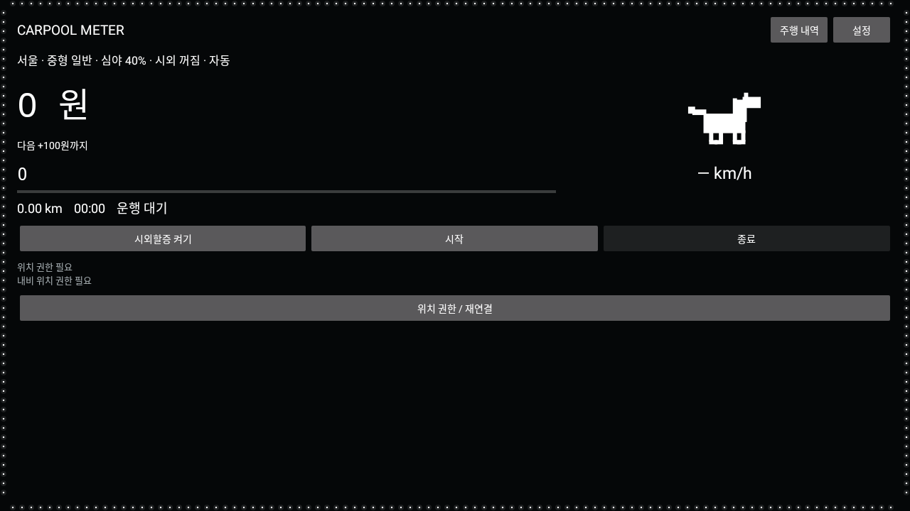
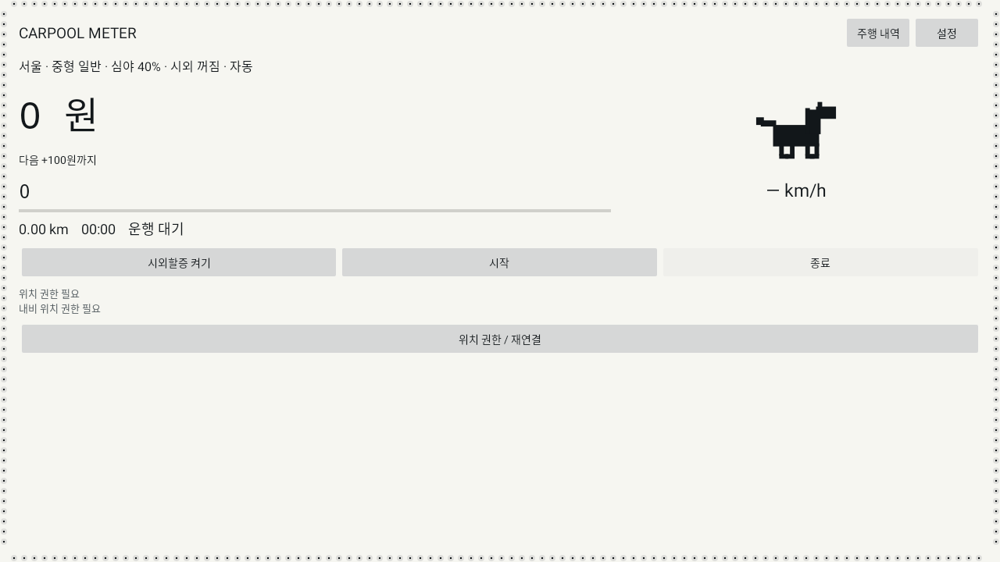

# 검증 결과

검증일: 2026-11-14

- assembleDebug: BUILD SUCCESSFUL
- 자동 테스트: 36개, 실패 0개
- lint: 0 errors, 16 warnings
- APK Signature Scheme v2 검증 통과
- APK SHA-256: `a8cf66e1307df33515453916187e200fdc208f947674cf3695c97d713b074574`

## 테스트 범위

- 위치 샘플 중복/역순/오래된 값/공백/비정상 이동 제외
- 한국 주소의 시도/시군 정규화 및 식별 불가 보류
- 요금표 입력/겹치는 심야 구간 검증
- 기본거리·증액·저속 시간·200원 단위 진행 숫자·일시정지·샘플 분할
- 심야 시작·자정·시외 중복·요율 전환과 기존 누적분 보존
- 행정구역 이탈/복귀 안정화·수동 모드·오래된 위치 보류
- 운행 계산 스냅샷 복원
- Robolectric Android API 28 및 34: 화면 시작, 메인→설정 수동 동기화, 요금표 JSON, SQLite 중복 저장 방지, 진행 운행 복원, 화면 재생성 및 이탈 일시정지
- Robolectric Native Graphics로 주간/야간 미터 렌더링 확인

## 렌더링

아래 이미지는 Robolectric에서 렌더링한 Android 화면이다. 실제 Pleos 서비스에서 받은 데이터나 에뮬레이터 실행 증거가 아니다.

## 남은 확인

실제 Pleos AVD/실차의 서비스 버전·권한·위치/주소/오도미터 수신과 경계 이동은 미검증. 현재 환경의 용량/가상화 제약으로 #1, #2, #11에서 계속 추적한다.

lint 경고에는 Pleos API 34 대상으로 인한 최신 target 권고, 한국어 문자열 현지화, 백업 XML/앱 아이콘 권고 등이 있다. 오류를 숨기는 baseline/suppression은 추가하지 않았다.
